# Research translated into engineering contracts

Updated: 2026-11-07. This map connects the public research and publication
records with inspectable implementations. The current implementation determines
technical status; a publication's architectural intention keeps its own date.

## From narrative sources to executable projections

The graph follows the visual convention of the
[SPIDER InterDead example](https://github.com/Zhovten-Games/SPIDER/tree/main/examples/interdead).
Author-owned narrative documents supply attributed snapshots. Technical cards,
localization keys and explicit review connect those snapshots to a versioned
content package. A portable C++20 Session owns legal actions, state, time and
knowledge. Console/Warden and WASM consume that Session; the Unreal adapter is
planned. The browser NOIR prototype and the TypeScript web packages have their
own runtime and release contracts.

```mermaid
flowchart TD
  A[Author documents] --> B[Technical content projection]
  B --> C[Versioned GitHub inputs]
  C --> D[Portable C++ core]
  D --> E[WASM]
  D --> F[Unreal adapter: planned]
  E --> G[Standalone Web Preview]
  E --> H[WordPress plugin build]
  I[GitLab engine assets: planned] --> F
  J[Workshop] -. production views .-> B
  J -. build review .-> G
  classDef layer fill:#111416,color:#e7ecea,stroke:#7f9298
  class A,B,C,D,E,F,G,H,I,J layer
```

## Publication-to-implementation map

| Research or public material | Concrete question or decision | Inspectable implementation |
| --- | --- | --- |
| [Language as Infection and the Systems of Horror](https://doi.org/10.5281/zenodo.19773963) | Fear mediated by language, perception, environment and signal; this supplies research vocabulary. | [Reference notes](README.md), [NIRO communication case](https://zhovten.games/blog/niro-communication-architecture), [From Body to Signal](https://web.zhovten.games/en/research/from-body-to-signal). |
| [Literate Programming review](https://doi.org/10.5281/zenodo.20608559) and [companion implementations](https://github.com/Zhovten-Games/literate-programming) | Preserve an explanatory source and produce reproducible machine artifacts. | [Why Documentation Matters](https://web.zhovten.games/en/programming/why-documentation-matters), [technical projection example](https://github.com/Zhovten-Games/SPIDER/tree/main/examples/interdead/content). |
| [Prompt-Literate Workflow](https://doi.org/10.5281/zenodo.20684079) | Connect a constrained assignment, generated candidate, verification and accepted source. | [Method repository](https://github.com/IRONCREED/prompt-literate-workflow), [SPIDER method](https://github.com/Zhovten-Games/SPIDER/blob/main/METHOD.md). |
| [Canon as a Contract](https://zhovten.games/blog/why-canon-contract-interdead) | Identify authoritative narrative sources, admissible interpretations and the status of drafts. | [Governed inheritance](https://github.com/Zhovten-Games/SPIDER/tree/main/examples/interdead/governance), the attributed content boundary above. |
| [Reproducible Artifact Pipeline](https://zhovten.games/blog/video-artifact-pipeline-interdead) | Preserve inputs, timing, renderer configuration and reproducible output. | [Media tooling](../tools/README.md), [deployment standards](../standards/deployment/README.md). |
| [Communication Architecture / NIRO](https://zhovten.games/blog/niro-communication-architecture) | Separate the speaker's admissible forms, communication protocol and the reader's interpretation. | [Public wiki](../wiki/README.md), [NOIR prototype](https://github.com/Zhovten-Games/InterDeadProto). |
| [The Constitution That Runs](https://web.zhovten.games/en/series/the-constitution-that-runs) | Make authority, amendment, execution and verification explicit in an engineering system. | [Universal source](https://github.com/FOP-Oksana-Dubinetska/code-constitution), [local profile](../governance/PROFILE.md) and [legislation](../governance/legislation/ECOSYSTEM.md). |
| [SPIDER](https://github.com/Zhovten-Games/SPIDER) | Express purpose, authority, candidate transition, validation, atomic commit/refusal and expected observations as readable contracts. | [InterDead examples](https://github.com/Zhovten-Games/SPIDER/tree/main/examples/interdead), [Workshop examples](https://github.com/Zhovten-Games/SPIDER/tree/main/examples/workshops). |
| Custom Operations Workspaces, October 2026 | Give several independent production systems one controlled workspace while preserving their source and authority boundaries. | [InterDead Workshop case](https://github.com/Zhovten-Games/SPIDER/tree/main/examples/workshops/examples/interdead), [EMBO case](https://github.com/Zhovten-Games/SPIDER/tree/main/examples/workshops/examples/embo). |

The linked studio blog addresses are publication-record locators. Their live
availability was not established during this review; the implementation links
and source registries remain separately identified. A source record's published
status is preserved without turning an inaccessible page into a verified live
deployment.

## Seven repositories, distinct responsibilities

| Repository | Current responsibility | Boundary to preserve |
| --- | --- | --- |
| [InterDeadReferenceLibrary](https://github.com/Zhovten-Games/InterDeadReferenceLibrary) | Public references, research and reusable tools. | Notes and examples have their own scope; private game sources remain attributed to their source owners. |
| [InterDeadProto](https://github.com/Zhovten-Games/InterDeadProto) | NOIR browser prototype, persistence, camera/inference and verified distribution. | Source, frozen artifact and generated `proto` branch have distinct status. |
| [InterDeadIT](https://github.com/Zhovten-Games/InterDeadIT) | Hugo public entry point and Cloudflare identity/EFBD Worker. | Public content access can be enabled without creating an authenticated user. |
| [InterDeadCore](https://github.com/Zhovten-Games/InterDeadCore) | TypeScript identity, EFBD and UI framework packages. | This package family owns web-side contracts. |
| [PsyFramework](https://github.com/Zhovten-Games/PsyFramework) | Configurable browser scoring research and transparent explanatory output. | Methodology data, scoring and presentation remain separate. |
| [InterDead](https://github.com/Zhovten-Games/InterDead) (private) | Portable C++20 game, content contracts, adapters and Workshop. | One Session owns executable game state; literary source and authorial approval retain their own authority. |
| [SPIDER](https://github.com/Zhovten-Games/SPIDER) | Shared literary contract method and public reconstructions. | Current public methodology and the game's historical pinned C++ bootstrap have different delivery roles. |

## Verification model

Warden invokes the real implementation through its declared input boundary.
Named checks report expected and observed values, source revision and actual
scope. Unit suites, browser integration, native scenarios and structural
methodology checks are adapters of this verification process. A structural pass
verifies structure; a game scenario verifies the selected Session behavior.
Physical camera permission and deployed-host observations keep separate records.

For bounded engineering work, select complete named scenario groups and retain
the remaining inventory. A public release still runs its complete required
corpus. Historical drivers retain their original bytes and cases; a changed
verification policy records its before/after control hashes and decision.

## Publication record status

The current studio LinkedIn registry records the literate-programming and IRON
CREED material cycle on 2026-09-12, earlier canon/communication/artifact cases
on 2026-02-20, and the studio anniversary on 2026-10-31
([anniversary post locator](https://lnkd.in/e-mHsQ5K)). The website EN umbrella
adaptation remains **approved / pending publication** in its source registry.
Its intended architecture is contextual evidence; current implementation pins
determine which adapters actually exist. DOI concept/version records retain
their published identifiers and are not normalized by replacing their suffixes.
